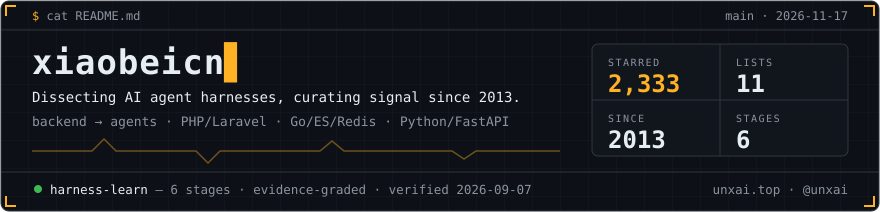
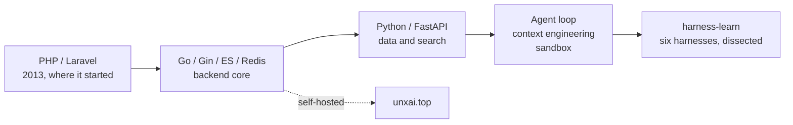

<!-- "Dissection bench" profile. Header artwork is generated by tools/gen_header.py;
     do not hand-edit the SVGs. Numbers refresh weekly via tools/refresh.py. -->

<picture>
  <source media="(prefers-color-scheme: dark)" srcset="assets/header-dark.svg" />
  <source media="(prefers-color-scheme: light)" srcset="assets/header-light.svg" />
  
</picture>

```text
$ whoami --verbose
name      Xiaobei Song (xiaobeicn)
base      backend · PHP/Laravel → Go/ES/Redis → Python/FastAPI
now       dissecting coding-agent harnesses, source first
method    every claim graded: source / docs / experiment / unverified
org       @unxai (personal) — https://unxai.top
```

## // Now dissecting

[harness-learn](https://github.com/xiaobeicn/harness-learn) — public notes that take apart six agent harnesses in order, from the smallest runtime to a composable, plugin-based harness. Notes are in Chinese; every conclusion carries an evidence grade, and nothing here is taken on trust.

| Stage | Harness | What it teaches |
|---|---|---|
| 01 | [Pi Mono](https://github.com/xiaobeicn/harness-learn/blob/main/01-pi-mono/README.md) | the minimal agent runtime |
| 02 | [OpenCode](https://github.com/xiaobeicn/harness-learn/blob/main/02-opencode/README.md) | a complete coding agent |
| 03 | [Codex CLI](https://github.com/xiaobeicn/harness-learn/blob/main/03-codex-cli/README.md) | production-grade sandboxing |
| 04 | [Claude Code](https://github.com/xiaobeicn/harness-learn/blob/main/04-claude-code/README.md) | the full harness architecture |
| 05 | [Prime Agent](https://github.com/xiaobeicn/harness-learn/blob/main/05-prime-agent/README.md) | RLM long tasks, self-evolving harness |
| 06 | [DeepSeek Harness](https://github.com/xiaobeicn/harness-learn/blob/main/06-deepseek-harness/README.md) | the composable, plugin-based harness |

Evidence grades: `source` · `docs` · `experiment` · `conclusion` · `limitation` · `unverified` / `speculation` — last verified against pinned upstream sources 2026-09-07. Also in the repo: [six-way comparison](https://github.com/xiaobeicn/harness-learn/blob/main/comparison.md) · [glossary](https://github.com/xiaobeicn/harness-learn/blob/main/glossary.md) · [pinned source versions](https://github.com/xiaobeicn/harness-learn/blob/main/source-versions.json).

## // Curated signal

2,333 starred repositories, sorted into 11 public lists. I read far more than I ship — the lists are the profile.

<!-- lists:counts-as-of 2026-11-17 -->

| List | Repos | List | Repos |
|---|---|---|---|
| [AI Agents, LLMs & GenAI](https://github.com/stars/xiaobeicn/lists/ai-agents-llms-genai) | 491 | [PHP & Laravel](https://github.com/stars/xiaobeicn/lists/php-laravel) | 303 |
| [JS/TS Tooling & Node](https://github.com/stars/xiaobeicn/lists/js-ts-tooling-node) | 264 | [Go & Backend](https://github.com/stars/xiaobeicn/lists/go-backend) | 257 |
| [Docs, Reading & Learning](https://github.com/stars/xiaobeicn/lists/docs-reading-learning) | 235 | [Frontend & UI](https://github.com/stars/xiaobeicn/lists/frontend-ui) | 189 |
| [Data & Databases](https://github.com/stars/xiaobeicn/lists/data-databases) | 190 | [Dev Tools, CLI & Security](https://github.com/stars/xiaobeicn/lists/dev-tools-cli-security) | 144 |
| [Infra, DevOps & Systems](https://github.com/stars/xiaobeicn/lists/infra-devops-systems) | 104 | [Python](https://github.com/stars/xiaobeicn/lists/python) | 96 |
| [Desktop, Mobile & Media](https://github.com/stars/xiaobeicn/lists/desktop-mobile-media) | 60 | | |

Counts as of 2026-11-17. Everything starred, unfiltered: [xiaobeicn?tab=stars](https://github.com/xiaobeicn?tab=stars).

## // Maintained

- [skills-summary](https://github.com/xiaobeicn/skills-summary) — ★ 267 — skills and knowledge notes, maintained since 2014.
- [text-similarity-php](https://github.com/xiaobeicn/text-similarity-php) — ★ 107 — cosine similarity plus segmentation, in one PHP class. 2014.
- [go-es-location](https://github.com/xiaobeicn/go-es-location) — Gin plus Elasticsearch plus IP2Location. Backend core, small and specific.

More under [@unxai](https://github.com/unxai), my personal org.

## // Stack, as a path



---

<!-- refreshed: 2026-11-17 -->

<sub>Since 2013-11-28 · This page is generated, not decorated · <a href="https://github.com/xiaobeicn/xiaobeicn">View source</a></sub>
